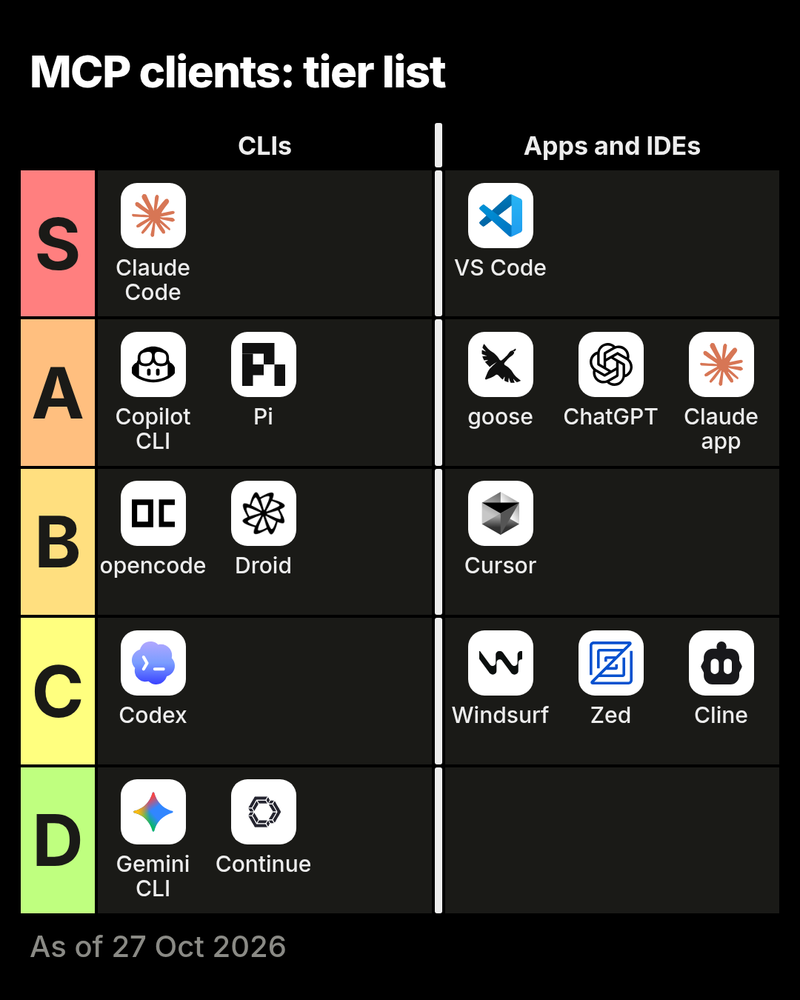
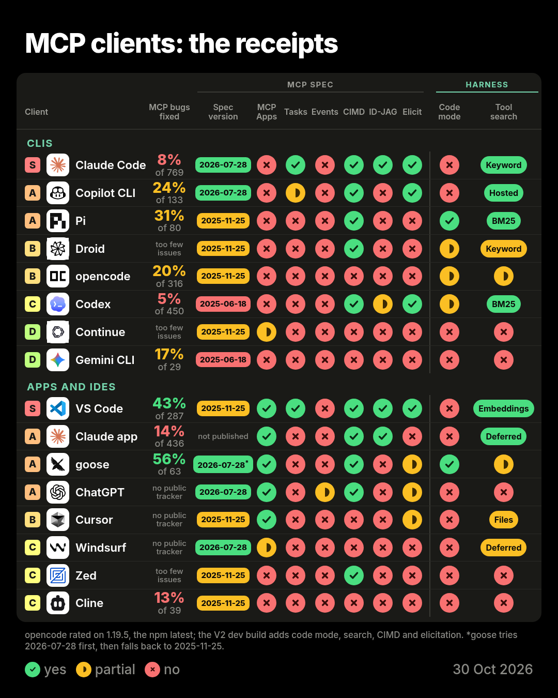
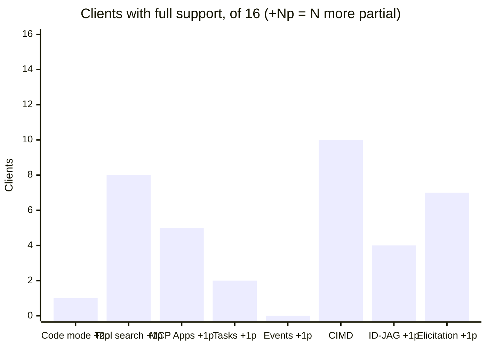
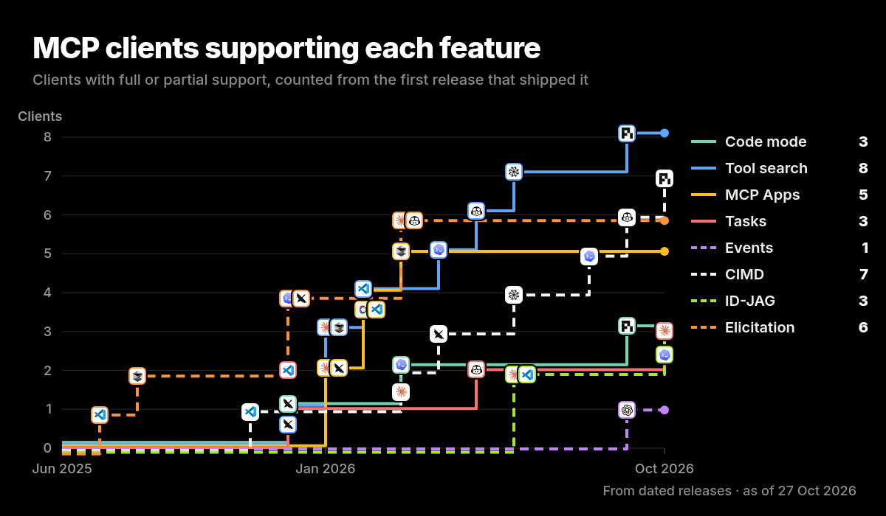
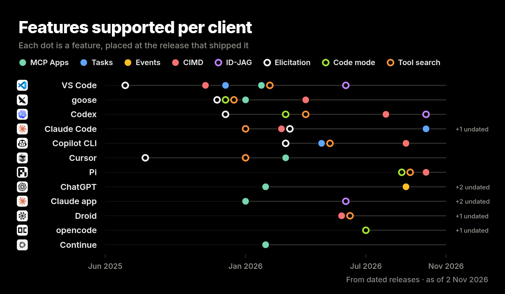
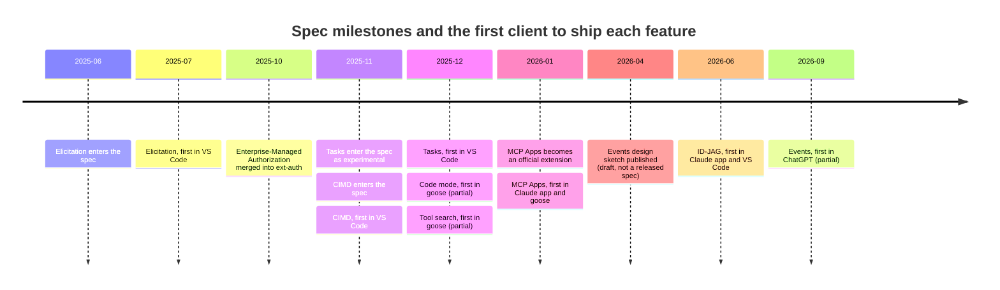
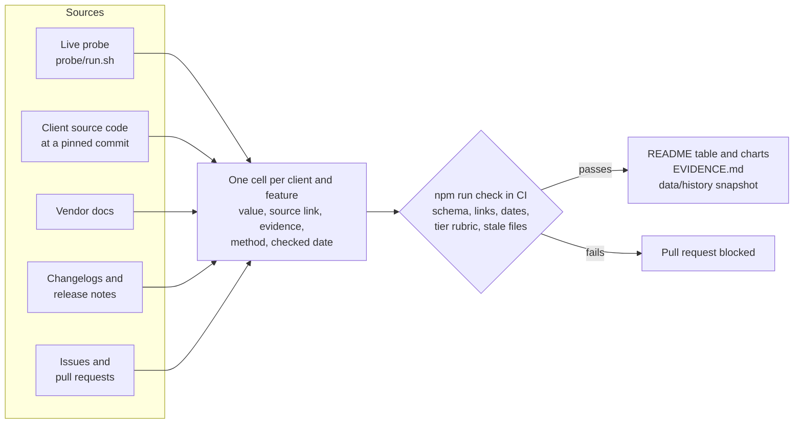
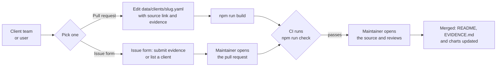

# MCP clients scorecard

Which MCP clients support which parts of the [Model Context Protocol](https://modelcontextprotocol.io), with a linked, dated source for every cell. Maintained by [StackOne](https://www.stackone.com).

[Scorecard](#scorecard) · [Feature support](#clients-supporting-each-feature) · [Adoption over time](#adoption-over-time) · [How the data is checked](#how-the-data-is-checked) · [Add or correct your client](#add-or-correct-your-client) · [Methodology](methodology/METHODOLOGY.md)

## Scorecard

<!-- table:start -->
<!-- Generated by `npm run build` from data/. Do not edit between the markers. -->

As of 27 Oct 2026. Click any cell for its source, or a client name for the full evidence.

### CLIs

| Tier | Client | Checked on | MCP bugs fixed | Spec version | Code mode | Tool search | MCP Apps | Tasks | Events | CIMD | ID-JAG | Elicitation |
| --- | --- | --- | --- | --- | --- | --- | --- | --- | --- | --- | --- | --- |
| **S** | [Claude Code](EVIDENCE.md#claude-code) | `2.1.311` | [8% of 769](https://github.com/anthropics/claude-code/issues) | [ 2026-07-28](https://code.claude.com/docs/en/changelog) |  | [ Deferred](https://code.claude.com/docs/en/mcp) |  |  |  |  |  |  |
| **A** | [Copilot CLI](EVIDENCE.md#copilot-cli) | `1.0.103` | [24% of 133](https://github.com/github/copilot-cli/issues) | [ 2026-07-28](https://github.com/github/copilot-cli/blob/main/changelog.md) |  | [ Deferred](https://docs.github.com/en/copilot/concepts/agents/copilot-cli/tool-search) |  |  |  |  |  |  |
| **A** | [Pi](EVIDENCE.md#pi) | `1.4.0` | [31% of 80](https://github.com/earendil-works/pi/issues) | [ 2025-11-25](https://github.com/earendil-works/pi/blob/6c384aa30f619d7b28963f2bab24d8dacbe73cb6/packages/mcp/src/protocol/types.ts#L4) |  | [ BM25](https://github.com/earendil-works/pi/blob/6c384aa30f619d7b28963f2bab24d8dacbe73cb6/packages/coding-agent/docs/codemode.md#L32) |  |  |  |  |  |  |
| **B** | [Droid](EVIDENCE.md#droid) | `0.249.0` | [too few issues](https://github.com/Factory-AI/factory/issues) | [ 2025-11-25](https://www.npmjs.com/package/@factory/cli-linux-x64/v/0.251.0) |  | [ On demand](https://docs.factory.ai/changelog/release-notes) |  |  |  |  |  |  |
| **B** | [opencode](EVIDENCE.md#opencode) | `1.19.4` | [20% of 316](https://github.com/anomalyco/opencode/issues) | [ 2025-11-25](https://github.com/anomalyco/opencode/blob/cd15a6a38b3852e40a2bea215e2393fe17700789/packages/schema/src/mcp.ts#L20) |  |  |  |  |  |  |  |  |
| **C** | [Codex](EVIDENCE.md#codex) | `0.164.0` | [5% of 450](https://github.com/openai/codex/issues) | [ 2025-06-18](https://github.com/openai/codex/releases) |  | [ BM25](https://github.com/openai/codex/pull/29486) |  |  |  |  |  |  |
| **D** | [Continue](EVIDENCE.md#continue) | `2.0.0` | [too few issues](https://github.com/continuedev/continue/issues) | [ 2025-11-25](https://github.com/continuedev/continue/blob/5522c6f44ca0ac3528b37244818fbfa39b5af470/core/context/mcp/MCPConnection.ts#L88) |  |  |  |  |  |  |  |  |
| **D** | [Gemini CLI](EVIDENCE.md#gemini-cli) | `0.65.0` | [17% of 29](https://github.com/google-gemini/gemini-cli/issues) | [ 2025-06-18](https://github.com/google-gemini/gemini-cli/blob/363a13119a57354f469732577518b9d6b319d1d6/packages/core/package.json#L34) |  |  |  |  |  |  |  |  |

### Apps and IDEs

| Tier | Client | Checked on | MCP bugs fixed | Spec version | Code mode | Tool search | MCP Apps | Tasks | Events | CIMD | ID-JAG | Elicitation |
| --- | --- | --- | --- | --- | --- | --- | --- | --- | --- | --- | --- | --- |
| **S** | [VS Code](EVIDENCE.md#vs-code) | `1.143.1` | [43% of 287](https://github.com/microsoft/vscode/issues) | [ 2025-11-25](https://github.com/microsoft/vscode/blob/ed3d9c11647cf2d6c7b0e4f327fd1c7c5f0afc6e/src/vs/workbench/contrib/mcp/common/mcpServerRequestHandler.ts#L116) |  | [ Embeddings](https://github.com/microsoft/vscode/blob/ed3d9c11647cf2d6c7b0e4f327fd1c7c5f0afc6e/extensions/copilot/src/extension/tools/node/toolSearchTool.ts) |  |  |  |  |  |  |
| **A** | [Claude app](EVIDENCE.md#claude-app) | hosted | [14% of 436](https://github.com/anthropics/claude-ai-mcp/issues) | [ not published](https://claude.com/docs/connectors/building) |  | [ Deferred](https://claude.com/docs/cowork/changelog) |  |  |  |  |  |  |
| **A** | [goose](EVIDENCE.md#goose) | `1.56.0` | [56% of 63](https://github.com/aaif-goose/goose/issues) | [ 2026-07-28 (falls back to 2025-11-25)](https://github.com/aaif-goose/goose/blob/0a2f30681566ec83e6359c375c7f5b36aa3567b2/crates/goose/src/agents/mcp_client.rs#L532) |  |  |  |  |  |  |  |  |
| **A** | [ChatGPT](EVIDENCE.md#chatgpt) | hosted | no public tracker | [ 2026-07-28](https://developers.openai.com/plugins/build/mcp-events) |  |  |  |  |  |  |  |  |
| **B** | [Cursor](EVIDENCE.md#cursor) | hosted | no public tracker | [ not published](https://zuplo.com/learn/mcp/compatibility/clients/cursor) |  | [ Files](https://cursor.com/blog/dynamic-context-discovery) |  |  |  |  |  |  |
| **C** | [Zed](EVIDENCE.md#zed) | `main@6b985a8` | [too few issues](https://github.com/zed-industries/zed/issues) | [ 2025-11-25](https://github.com/zed-industries/zed/blob/6b985a8b264165f2bf4cd04a8be1cdb40286ebe5/crates/context_server/src/protocol.rs#L42) |  |  |  |  |  |  |  |  |
| **C** | [Cline](EVIDENCE.md#cline) | `4.1.26` | [13% of 39](https://github.com/cline/cline/issues) | [ 2025-11-25](https://github.com/cline/cline/blob/c35b729049c7bb26c340df63ea9235c40b32dd29/apps/vscode/src/services/mcp/McpHub.ts#L466) |  |  |  |  |  |  |  |  |
| **C** | [Windsurf](EVIDENCE.md#windsurf) | hosted | no public tracker | [ 2026-07-28](https://docs.devin.ai/desktop/changelog) |  |  |  |  |  |  |  |  |

- **opencode**: Rated on 1.19.4, the npm latest. The V2 dev build adds code mode, tool search, CIMD and elicitation.
- **Continue**: Repository is read-only and no longer maintained.
- **goose**: Tries the 2026-07-28 handshake first, then falls back to 2025-11-25.
<!-- table:end -->

### What the columns mean

<!-- columns:start -->
| Column | Meaning | Defined in |
| --- | --- | --- |
| Spec version | The newest protocol version the client negotiates. Green is the current spec, orange is one version behind, red is older, and an empty circle means the client does not publish one. | [MCP specification](https://modelcontextprotocol.io/specification/2026-07-28/changelog) |
| Code mode | The client lets the model write a script that calls MCP tools, instead of making one tool call per step. | [Client feature (described by Cloudflare and Anthropic)](https://www.anthropic.com/engineering/code-execution-with-mcp) |
| Tool search | The client loads tool definitions on demand instead of putting every tool into the context window. The label says how it searches. | [Client feature (described by Anthropic)](https://www.anthropic.com/engineering/advanced-tool-use) |
| MCP Apps | The client renders interactive UI that a server returns. | [MCP Apps extension (io.modelcontextprotocol/ui)](https://modelcontextprotocol.io/extensions/apps/overview) |
| Tasks | The client supports tasks for long-running tool calls that the client polls for a result. Experimental in the 2025-11-25 spec, moved to an official extension in 2026-07-28. | [MCP Tasks extension (io.modelcontextprotocol/tasks)](https://modelcontextprotocol.io/extensions/tasks/overview) |
| Events | The client accepts events that a server pushes, without the client polling for them. The working group has a draft design sketch; no spec release defines events yet. | [Triggers and Events working group (draft design sketch, not a released spec)](https://github.com/modelcontextprotocol/experimental-ext-triggers-events) |
| CIMD | The client registers with OAuth servers through a Client ID Metadata Document, which the 2026-07-28 spec prefers over dynamic client registration. | [MCP authorization, client registration](https://modelcontextprotocol.io/specification/2026-07-28/basic/authorization/client-registration) |
| ID-JAG | The client supports enterprise-managed authorization, where the company's identity provider issues the token for the MCP server. | [Enterprise-Managed Authorization extension](https://modelcontextprotocol.io/extensions/auth/enterprise-managed-authorization) |
| Elicitation | The client lets a server ask the user for input mid-call, in a form or by sending them to a URL. | [MCP specification, client elicitation](https://modelcontextprotocol.io/specification/2026-07-28/client/elicitation) |
| MCP bugs fixed | The share of the client's MCP issues closed as completed. | [Methodology](methodology/METHODOLOGY.md#mcp-bugs-fixed) |
<!-- columns:end -->

 means partial: behind a flag, off by default, experimental, or only one of two modes.  means not supported, or not documented anywhere we could find. If you can point to a source that says otherwise, [send it in](#add-or-correct-your-client).

## Clients supporting each feature

<!-- features:start -->

Counts as a table

| Feature |  Yes |  Partial |  No |
| --- | --- | --- | --- |
| Code mode | 1 | 2 | 13 |
| Tool search | 8 | 1 | 7 |
| MCP Apps | 5 | 1 | 10 |
| Tasks | 2 | 1 | 13 |
| Events | 0 | 1 | 15 |
| CIMD | 10 | 0 | 6 |
| ID-JAG | 4 | 1 | 11 |
| Elicitation | 7 | 1 | 8 |

<!-- features:end -->

## Adoption over time

<!-- adoption:start -->

Dated from the first release that shipped each feature; cells without a verified date are left out. 36 of 45 supported cells carry a date. See [methodology](methodology/METHODOLOGY.md#dating-support).

Undated supported cells per feature

| Feature | Dated | Undated |
| --- | --- | --- |
| Code mode | 3 | 0 |
| Tool search | 8 | 1 |
| MCP Apps | 5 | 1 |
| Tasks | 3 | 0 |
| Events | 1 | 0 |
| CIMD | 7 | 3 |
| ID-JAG | 3 | 2 |
| Elicitation | 6 | 2 |

<!-- adoption:end -->

Each build also writes a snapshot of every cell to [data/history/](data/history/), named by the `as_of` date, so changes between reviews stay on record.

## How the data is checked

Every cell in [data/clients/](data/clients/) carries the URL it was checked against, the date, and how it was checked:

- `probe`: a live handshake. [probe/run.sh](probe/run.sh) installs six CLIs (Claude Code, Copilot CLI, Codex, Gemini CLI, opencode and Droid) at their npm latest and points it at a one-tool server built on the official SDK, which logs the protocol version the client sends. See [methodology/PROBE.md](methodology/PROBE.md).
- `source`: the client's own code, at a pinned commit or published package.
- `docs` and `changelog`: the vendor's own pages.
- `issue`: a GitHub issue or pull request.

[EVIDENCE.md](EVIDENCE.md) lists every cell with its source. Tiers follow the rules in [methodology/RUBRIC.md](methodology/RUBRIC.md), and the build fails if a client sits in a tier the rubric does not give it without a written reason.

## Add or correct your client

If you build an MCP client and the table is wrong or out of date, send us the proof. Every change needs a public https source: a docs page, a changelog entry, a release, or a line of code.

### List your client

1. Copy [data/clients/_template.yaml](data/clients/_template.yaml) to `data/clients/<slug>.yaml`, where the slug is your client's name in lower case with hyphens.
2. Add a square SVG logo to [assets/logos/](assets/logos/) and name it in `logo`.
3. Fill in all nine cells. Each one needs a value, a public https `source`, one sentence of `evidence` and the date you checked it. Add `since` with the release that first shipped a feature, so your client shows up in the adoption charts.
4. Run `npm ci && npm run build`. The build validates the file, prints the tier the rubric gives, and regenerates the tables and charts.
5. Open a pull request. CI runs `npm run check`, and a maintainer opens every source before merging.

No time for a pull request? Use the [list a client form](../../issues/new?template=list-client.yml) with your docs and changelog links, and we will do the rest.

### Update a cell with proof

1. Edit the cell in your client's file: change `value`, point `source` at the page, release or permalink that shows it, and update `evidence` and `checked`.
2. If a release note dates the feature, add `since` with its date, version and link.
3. Run `npm run build` and open a pull request, or file the [submit evidence form](../../issues/new?template=submit-evidence.yml) with the feature, the value and the source link.

[CONTRIBUTING.md](CONTRIBUTING.md) lists every field and the sources we accept. Every client also gets a badge in [assets/badges/](assets/badges/) that follows its tier; [the snippet](CONTRIBUTING.md#badge-for-your-readme) shows how to embed it.

## Methodology

- Each feature cell is `y`, `p` or `n`, and needs a source link, a method and a checked date. Partial covers flags, defaults that are off, experimental builds and one of two modes.
- The spec version is the newest protocol revision a client negotiates, graded against the list in [data/meta.yaml](data/meta.yaml).
- MCP bugs fixed is completed issues over issues minus duplicates, for MCP issues opened since the current spec shipped. Below 20 issues no rate is shown.
- Tiers come from the feature score, the spec grade and the fix rate, using the rules in [methodology/RUBRIC.md](methodology/RUBRIC.md).
- Adoption charts count a cell from the first release that shipped it, and only when a release note or changelog dates that release.

Full detail, including limitations, is in [methodology/METHODOLOGY.md](methodology/METHODOLOGY.md).

## Updates

s2d2, StackOne's internal agent, checks every Monday. It bumps each CLI to its npm latest and probes it again, recounts MCP issues, rechecks the sources behind every partial or unsupported cell, then opens a pull request with what changed. Nothing reaches `main` without a review.

The tables and charts are generated from `data/`, never edited by hand. On every push to a branch other than `main`, the [build workflow](.github/workflows/build.yml) runs `npm run build` with Chrome, commits any regenerated README sections, EVIDENCE.md, history snapshot, badges and PNGs back to that branch, then runs the [check workflow](.github/workflows/check.yml) on the new commit. A pull request from a branch of this repository that only edits a YAML file therefore gets its tables and charts redrawn before review. A pull request from a fork gets the same only when Actions is enabled on the fork; otherwise a maintainer rebuilds ([CONTRIBUTING.md](CONTRIBUTING.md)).

## Repository layout

| Path | What it holds |
| --- | --- |
| [data/clients/](data/clients/) | One YAML file per client: links, version checked, and the nine cells with their evidence |
| [data/features.yaml](data/features.yaml) | One entry per column, with its definition and where the spec or extension defines it |
| [data/meta.yaml](data/meta.yaml) | Review date, spec versions, bug window |
| [data/bugs.json](data/bugs.json) | MCP issue counts per tracker, from `npm run bugs` |
| [data/history/](data/history/) | Generated snapshot of every cell per review date |
| [methodology/](methodology/) | How each column is graded, the tier rubric, the live probe |
| [probe/](probe/) | The handshake probe and its MCP server |
| [render/](render/) | Loader, validation and generators for the README, EVIDENCE.md and images |

Field reference for every data file: [data/README.md](data/README.md).

## Commands

| Command | What it does |
| --- | --- |
| `npm run build` | Regenerates the README sections, EVIDENCE.md, the history snapshot, the badges and the PNGs (needs Chrome, or `CHROME_PATH`) |
| `npm run build -- --no-images` | The same, without the PNGs |
| `npm run build -- --all-images` | Re-renders every PNG, not only the charts whose data changed |
| `npm run check` | Validates the data and fails if a generated file or image is stale |
| `npm run bugs` | Recounts MCP issues per tracker with the GitHub search API (needs `gh`, signed in) |
| `npm run probe` | Runs the live handshake probe against each CLI and writes `probe/results.json` |
| `npm test` | Tests the probe report on sample handshake logs |

## Why StackOne tracks this

[StackOne](https://www.stackone.com) builds the tool layer between AI agents and the business apps they act on, and ships MCP servers for it. Which client features work in practice decides what we can ship to customers, so we track it here in the open with a source behind every claim.

## License

[MIT](LICENSE). Maintained by [StackOne](https://www.stackone.com). Corrections are welcome through [pull requests and the evidence form](#add-or-correct-your-client).
