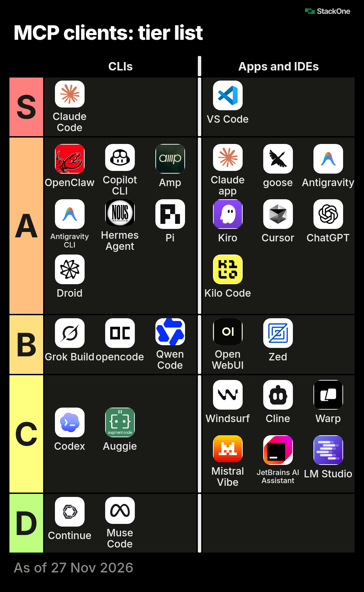
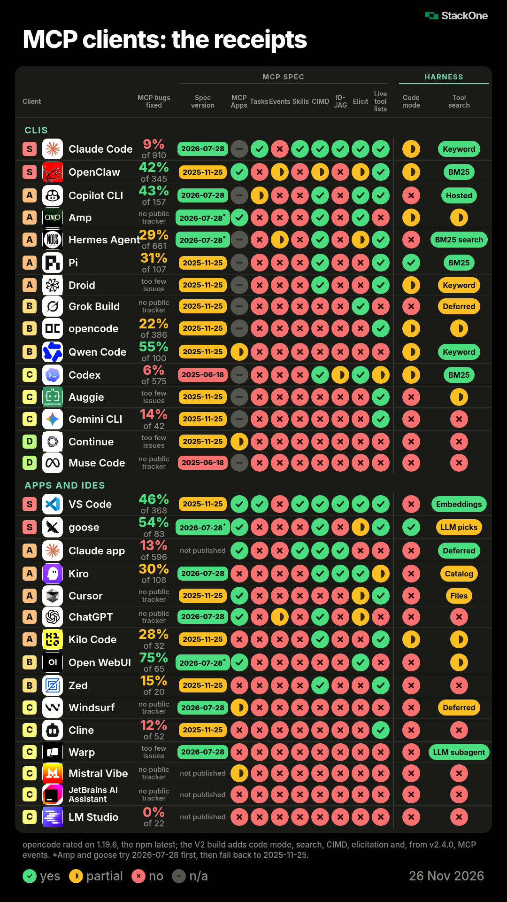
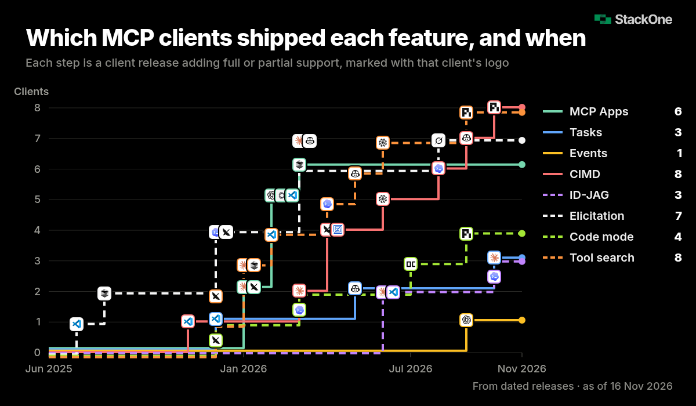
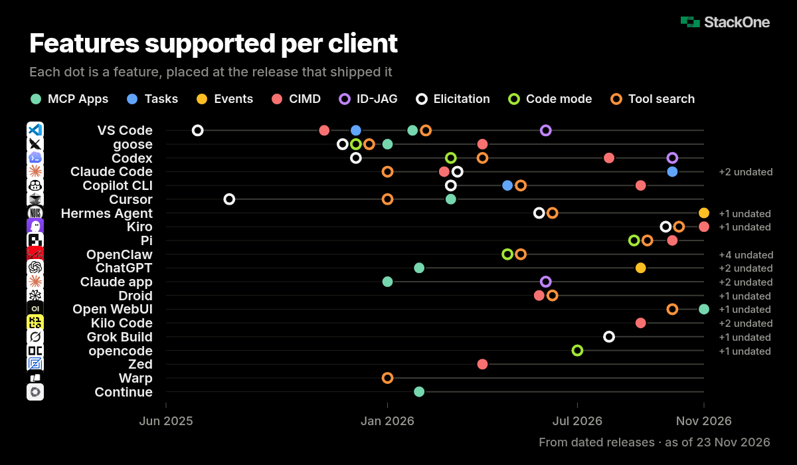
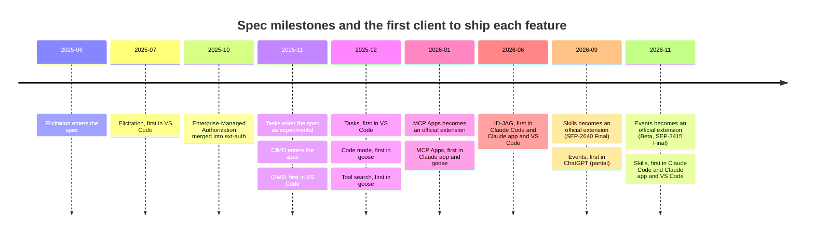
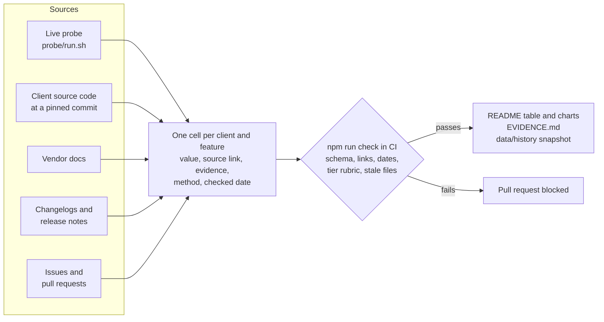
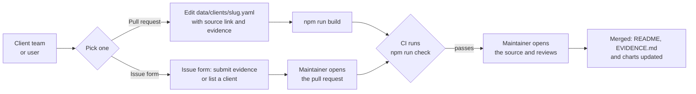

# MCP clients scorecard

Which MCP clients support which parts of the [Model Context Protocol](https://modelcontextprotocol.io), with a linked, dated source for every cell. Maintained by [StackOne](https://www.stackone.com). Browse it at [mcpclients.dev](https://mcpclients.dev).

[Recent changes](#recent-changes) · [Scorecard](#scorecard) · [Feature support](#clients-supporting-each-feature) · [Adoption over time](#adoption-over-time) · [How the data is checked](#how-the-data-is-checked) · [Add or correct your client](#add-or-correct-your-client) · [Methodology](methodology/METHODOLOGY.md)

## Recent changes

<!-- changes:start -->
<!-- Generated by `npm run build` from data/. Do not edit between the markers. -->

The last 30 days to 27 Nov 2026. Clients: 15 · Feature support: 26 · Tier moves: 8 · Spec: 1. Board changes carry the date of the weekly check, shipped features the date of their release note. Feeds: [Atom](https://mcpclients.dev/changelog.xml) · [JSON](https://mcpclients.dev/changelog.json)

| Date | Kind | Change |
| --- | --- | --- |
| 2026-11-27 | Client | [Antigravity](EVIDENCE.md#antigravity) joins the board in A tier |
| 2026-11-27 | Tier | [goose](EVIDENCE.md#goose) moves down from S to A tier |
| 2026-11-27 | Tier | [OpenClaw](EVIDENCE.md#openclaw) moves down from S to A tier |
| 2026-11-24 | Feature | [Claude app](EVIDENCE.md#claude-app) ships Skills ([source](https://claude.com/resources/articles/skills-over-mcp-tasks-and-more)) |
| 2026-11-24 | Feature | [Claude app](EVIDENCE.md#claude-app) ships Tasks ([source](https://claude.com/resources/articles/skills-over-mcp-tasks-and-more)) |
| 2026-11-24 | Feature | [Claude Code](EVIDENCE.md#claude-code) ships Skills in 2.1.332 ([source](https://www.npmjs.com/package/@anthropic-ai/claude-code/v/2.1.332)) |
| 2026-11-23 | Client | [Hermes Agent](EVIDENCE.md#hermes-agent) joins the board in A tier |
| 2026-11-23 | Client | [Open WebUI](EVIDENCE.md#open-webui) joins the board in B tier |
| 2026-11-23 | Client | [OpenClaw](EVIDENCE.md#openclaw) joins the board in S tier |
| 2026-11-23 | Feature | [Gemini CLI](EVIDENCE.md#gemini-cli) rechecked: spec version 2025-06-18 → 2025-11-25 |

40 more from the last 30 days

| Date | Kind | Change |
| --- | --- | --- |
| 2026-11-23 | Feature | [goose](EVIDENCE.md#goose) rechecked: Tool search partly → yes |
| 2026-11-23 | Tier | [Gemini CLI](EVIDENCE.md#gemini-cli) moves up from D to C tier |
| 2026-11-22 | Client | [Amp](EVIDENCE.md#amp) joins the board in A tier |
| 2026-11-22 | Client | [Auggie](EVIDENCE.md#auggie) joins the board in C tier |
| 2026-11-22 | Client | [JetBrains AI Assistant](EVIDENCE.md#jetbrains-ai-assistant) joins the board in C tier |
| 2026-11-22 | Client | [Kilo Code](EVIDENCE.md#kilo-code) joins the board in A tier |
| 2026-11-22 | Client | [Kiro](EVIDENCE.md#kiro) joins the board in A tier |
| 2026-11-22 | Client | [LM Studio](EVIDENCE.md#lm-studio) joins the board in C tier |
| 2026-11-22 | Client | [Mistral Vibe](EVIDENCE.md#mistral-vibe) joins the board in C tier |
| 2026-11-22 | Client | [Qwen Code](EVIDENCE.md#qwen-code) joins the board in B tier |
| 2026-11-22 | Client | [Warp](EVIDENCE.md#warp) joins the board in C tier |
| 2026-11-20 | Feature | [Antigravity](EVIDENCE.md#antigravity) ships MCP Apps in 2.34.0 ([source](https://antigravity.google/docs/changelog#rel-hub-2.34.0)) |
| 2026-11-19 | Spec | Events becomes an official extension (Beta, SEP-3415 Final) ([source](https://modelcontextprotocol.io/seps/3415-events-extension)) |
| 2026-11-17 | Feature | [Kiro](EVIDENCE.md#kiro) ships ID-JAG in 3.5.0 ([source](https://kiro.dev/changelog/cli/3-5)) |
| 2026-11-16 | Feature | [Grok Build](EVIDENCE.md#grok-build) rechecked: Elicitation partly → yes |
| 2026-11-16 | Tier | [Grok Build](EVIDENCE.md#grok-build) moves up from C to B tier |
| 2026-11-11 | Feature | [VS Code](EVIDENCE.md#vs-code) ships Skills in 1.146.0 ([source](https://github.com/microsoft/vscode-docs/blob/main/release-notes/v1_146.md)) |
| 2026-11-10 | Feature | [Kiro](EVIDENCE.md#kiro) ships CIMD in 3.2.0 ([source](https://kiro.dev/changelog/cli/3-2/)) |
| 2026-11-09 | Feature | [Droid](EVIDENCE.md#droid) rechecked: Live tool lists no → yes |
| 2026-11-09 | Tier | [Droid](EVIDENCE.md#droid) moves up from B to A tier |
| 2026-11-08 | Client | [Grok Build](EVIDENCE.md#grok-build) joins the board in C tier |
| 2026-11-08 | Client | [Muse Code](EVIDENCE.md#muse-code) joins the board in D tier |
| 2026-11-06 | Feature | [Claude Code](EVIDENCE.md#claude-code) rechecked: Code mode no → partly |
| 2026-11-05 | Feature | [Hermes Agent](EVIDENCE.md#hermes-agent) ships Events (partly) in v0.23.0 ([source](https://github.com/NousResearch/hermes-agent/releases/tag/v0.23.0)) |
| 2026-11-03 | Feature | [Open WebUI](EVIDENCE.md#open-webui) ships MCP Apps in 0.13.0 ([source](https://github.com/open-webui/open-webui/releases/tag/v0.13.0)) |
| 2026-11-02 | Feature | [Claude Code](EVIDENCE.md#claude-code) rechecked: MCP Apps no → n/a |
| 2026-11-02 | Feature | [Codex](EVIDENCE.md#codex) rechecked: MCP Apps no → n/a |
| 2026-11-02 | Feature | [Copilot CLI](EVIDENCE.md#copilot-cli) rechecked: MCP Apps no → n/a |
| 2026-11-02 | Feature | [Droid](EVIDENCE.md#droid) rechecked: MCP Apps no → n/a |
| 2026-11-02 | Feature | [Gemini CLI](EVIDENCE.md#gemini-cli) rechecked: MCP Apps no → n/a |
| 2026-11-02 | Feature | [opencode](EVIDENCE.md#opencode) rechecked: MCP Apps no → n/a |
| 2026-11-02 | Feature | [Pi](EVIDENCE.md#pi) rechecked: MCP Apps no → n/a |
| 2026-11-02 | Tier | [Cursor](EVIDENCE.md#cursor) moves up from B to A tier |
| 2026-11-02 | Tier | [goose](EVIDENCE.md#goose) moves up from A to S tier |
| 2026-11-02 | Tier | [Zed](EVIDENCE.md#zed) moves up from C to B tier |
| 2026-10-30 | Feature | [ChatGPT](EVIDENCE.md#chatgpt) rechecked: Elicitation yes → partly |
| 2026-10-30 | Feature | [Cursor](EVIDENCE.md#cursor) rechecked: spec version not published → 2025-11-25, ID-JAG yes → no, Elicitation yes → partly |
| 2026-10-30 | Feature | [Droid](EVIDENCE.md#droid) rechecked: Elicitation partly → no, Code mode no → partly |
| 2026-10-30 | Feature | [goose](EVIDENCE.md#goose) rechecked: Elicitation yes → partly, Code mode partly → yes |
| 2026-10-30 | Feature | [Windsurf](EVIDENCE.md#windsurf) rechecked: MCP Apps no → partly, Tool search no → yes |

Older changes (75)

| Date | Kind | Change |
| --- | --- | --- |
| 2026-10-27 | Client | Scorecard published with 16 clients |
| 2026-10-23 | Feature | [Codex](EVIDENCE.md#codex) ships ID-JAG (partly) in 0.164.0 ([source](https://github.com/openai/codex/releases/tag/rust-v0.164.0)) |
| 2026-10-23 | Feature | [Kiro](EVIDENCE.md#kiro) ships Elicitation in 2.34.0 ([source](https://kiro.dev/changelog/cli/2-34/)) |
| 2026-10-19 | Feature | [Claude Code](EVIDENCE.md#claude-code) ships Tasks in 2.1.304 ([source](https://code.claude.com/docs/en/mcp)) |
| 2026-10-15 | Feature | [OpenClaw](EVIDENCE.md#openclaw) ships Events (partly) in 2026.10.10-beta.1 ([source](https://github.com/openclaw/openclaw/releases/tag/v2026.10.10-beta.1)) |
| 2026-10-14 | Feature | [Mistral Vibe](EVIDENCE.md#mistral-vibe) ships MCP Apps (partly) ([source](https://docs.mistral.ai/resources/release-note/2026-10-14-workflow-visualizer)) |
| 2026-10-13 | Feature | [Kiro](EVIDENCE.md#kiro) ships Tool search in 1.3.0 ([source](https://kiro.dev/changelog/ide/1-3/)) |
| 2026-10-10 | Feature | [Open WebUI](EVIDENCE.md#open-webui) ships Elicitation in 0.12.0 ([source](https://github.com/open-webui/open-webui/releases/tag/v0.12.0)) |
| 2026-10-10 | Feature | [Open WebUI](EVIDENCE.md#open-webui) ships Tool search (partly) in 0.12.0 ([source](https://github.com/open-webui/open-webui/releases/tag/v0.12.0)) |
| 2026-10-05 | Feature | [OpenClaw](EVIDENCE.md#openclaw) ships Elicitation (partly) in 2026.10.1-beta.1 ([source](https://github.com/openclaw/openclaw/releases/tag/v2026.10.1-beta.1)) |
| 2026-10-03 | Feature | [Pi](EVIDENCE.md#pi) ships CIMD in 1.0.1 ([source](https://github.com/earendil-works/pi/releases/tag/v1.0.1)) |
| 2026-09-29 | Feature | [ChatGPT](EVIDENCE.md#chatgpt) ships Events (partly) ([source](https://help.openai.com/en/articles/6825453-chatgpt-release-notes)) |
| 2026-09-29 | Feature | [Pi](EVIDENCE.md#pi) ships Code mode in 0.99.0 ([source](https://github.com/earendil-works/pi/releases/tag/v0.99.0)) |
| 2026-09-29 | Feature | [Pi](EVIDENCE.md#pi) ships Tool search in 0.99.0 ([source](https://github.com/earendil-works/pi/releases/tag/v0.99.0)) |
| 2026-09-24 | Feature | [Kilo Code](EVIDENCE.md#kilo-code) ships CIMD in 7.7.12 ([source](https://github.com/Kilo-Org/kilocode/releases/tag/v7.7.12)) |
| 2026-09-14 | Feature | [Qwen Code](EVIDENCE.md#qwen-code) ships Code mode (partly) in 0.23.4 ([source](https://github.com/QwenLM/qwen-code/releases/tag/v0.23.4)) |
| 2026-09-13 | Spec | Skills becomes an official extension (SEP-2640 Final) ([source](https://github.com/modelcontextprotocol/modelcontextprotocol/pull/2640)) |
| 2026-09-04 | Feature | [Copilot CLI](EVIDENCE.md#copilot-cli) ships CIMD in 1.0.83 ([source](https://github.com/github/copilot-cli/releases/tag/v1.0.83)) |
| 2026-08-26 | Feature | [Qwen Code](EVIDENCE.md#qwen-code) ships MCP Apps (partly) in 0.22.2 ([source](https://github.com/QwenLM/qwen-code/releases/tag/v0.22.2)) |
| 2026-08-21 | Feature | [Hermes Agent](EVIDENCE.md#hermes-agent) ships CIMD in 0.20.5 ([source](https://github.com/NousResearch/hermes-agent/releases/tag/v2026.8.19)) |
| 2026-08-20 | Feature | [Grok Build](EVIDENCE.md#grok-build) ships Elicitation in 1.0.8 ([source](https://github.com/xai-org/grok-build/blob/2bdd1d6a6369de0e8c68132ea4539e9abd9e14a8/crates/codegen/xai-grok-shell/changelogs/1.0.8.md)) |
| 2026-08-18 | Feature | [Codex](EVIDENCE.md#codex) ships CIMD in 0.148.0 ([source](https://github.com/openai/codex/releases/tag/rust-v0.148.0)) |
| 2026-08-13 | Feature | [Kilo Code](EVIDENCE.md#kilo-code) ships Code mode (partly) in 7.4.22 ([source](https://github.com/Kilo-Org/kilocode/releases/tag/v7.4.22)) |
| 2026-08-13 | Feature | [Kilo Code](EVIDENCE.md#kilo-code) ships Tool search (partly) in 7.4.22 ([source](https://github.com/Kilo-Org/kilocode/releases/tag/v7.4.22)) |
| 2026-07-28 | Spec | MCP spec 2026-07-28 released ([source](https://modelcontextprotocol.io/specification/2026-07-28)) |
| 2026-07-15 | Feature | [OpenClaw](EVIDENCE.md#openclaw) ships MCP Apps in 2026.7.2-beta.1 ([source](https://github.com/openclaw/openclaw/releases/tag/v2026.7.2-beta.1)) |
| 2026-07-06 | Feature | [opencode](EVIDENCE.md#opencode) ships Code mode (partly) in 1.17.14 ([source](https://github.com/anomalyco/opencode/releases/tag/v1.17.14)) |
| 2026-07-06 | Feature | [opencode](EVIDENCE.md#opencode) ships Tool search (partly) in 1.17.14 ([source](https://github.com/anomalyco/opencode/releases/tag/v1.17.14)) |
| 2026-06-19 | Feature | [Hermes Agent](EVIDENCE.md#hermes-agent) ships Elicitation (partly) in v2026.6.19 ([source](https://github.com/NousResearch/hermes-agent/releases/tag/v2026.6.19)) |
| 2026-06-18 | Feature | [Claude app](EVIDENCE.md#claude-app) ships ID-JAG ([source](https://claude.com/resources/articles/enterprise-managed-auth)) |
| 2026-06-18 | Feature | [Claude Code](EVIDENCE.md#claude-code) ships ID-JAG ([source](https://claude.com/blog/enterprise-managed-auth)) |
| 2026-06-12 | Feature | [Droid](EVIDENCE.md#droid) ships CIMD in 0.147.0 ([source](https://docs.factory.com/changelog/release-notes)) |
| 2026-06-06 | Feature | [Hermes Agent](EVIDENCE.md#hermes-agent) ships Tool search in v2026.6.5 ([source](https://github.com/NousResearch/hermes-agent/releases/tag/v2026.6.5)) |
| 2026-06-03 | Feature | [Droid](EVIDENCE.md#droid) ships Tool search in 0.140.0 ([source](https://docs.factory.com/changelog/release-notes)) |
| 2026-06-03 | Feature | [VS Code](EVIDENCE.md#vs-code) ships ID-JAG in 1.123 ([source](https://code.visualstudio.com/updates/v1_123#_enterprise-managed-mcp-authentication-preview)) |
| 2026-05-31 | Feature | [OpenClaw](EVIDENCE.md#openclaw) ships CIMD (partly) in 2026.5.30-beta.1 ([source](https://github.com/openclaw/openclaw/releases/tag/v2026.5.30-beta.1)) |
| 2026-05-19 | Feature | [Copilot CLI](EVIDENCE.md#copilot-cli) ships Tool search in 1.0.49 ([source](https://github.com/github/copilot-cli/releases/tag/v1.0.49)) |
| 2026-05-14 | Feature | [OpenClaw](EVIDENCE.md#openclaw) ships Code mode (partly) in 2026.5.12 ([source](https://github.com/openclaw/openclaw/releases/tag/v2026.5.12)) |
| 2026-05-14 | Feature | [OpenClaw](EVIDENCE.md#openclaw) ships Tool search in 2026.5.12 ([source](https://github.com/openclaw/openclaw/releases/tag/v2026.5.12)) |
| 2026-05-10 | Feature | [Qwen Code](EVIDENCE.md#qwen-code) ships Tool search in 0.15.10 ([source](https://github.com/QwenLM/qwen-code/releases/tag/v0.15.10)) |
| 2026-05-05 | Feature | [Copilot CLI](EVIDENCE.md#copilot-cli) ships Tasks (partly) in 1.0.41 ([source](https://github.com/github/copilot-cli/releases/tag/v1.0.41)) |
| 2026-04-23 | Feature | [goose](EVIDENCE.md#goose) ships CIMD in 1.32.0 ([source](https://github.com/aaif-goose/goose/releases/tag/v1.32.0)) |
| 2026-04-10 | Feature | [Codex](EVIDENCE.md#codex) ships Tool search in 0.119.0 ([source](https://github.com/openai/codex/releases/tag/rust-v0.119.0)) |
| 2026-04-01 | Feature | [Zed](EVIDENCE.md#zed) ships CIMD in v0.230.0 ([source](https://github.com/zed-industries/zed/releases/tag/v0.230.0)) |
| 2026-03-20 | Feature | [Claude Code](EVIDENCE.md#claude-code) ships CIMD in 2.1.81 ([source](https://github.com/anthropics/claude-code/releases/tag/v2.1.81)) |
| 2026-03-14 | Feature | [Claude Code](EVIDENCE.md#claude-code) ships Elicitation in 2.1.76 ([source](https://github.com/anthropics/claude-code/releases/tag/v2.1.76)) |
| 2026-03-11 | Feature | [Codex](EVIDENCE.md#codex) ships Code mode (partly) in 0.114.0 ([source](https://github.com/openai/codex/releases/tag/rust-v0.114.0)) |
| 2026-03-03 | Feature | [Copilot CLI](EVIDENCE.md#copilot-cli) ships Elicitation in 0.0.421 ([source](https://github.com/github/copilot-cli/releases/tag/v0.0.421)) |
| 2026-03-03 | Feature | [Cursor](EVIDENCE.md#cursor) ships MCP Apps in 2.6 ([source](https://cursor.com/changelog/2-6)) |
| 2026-02-22 | Feature | [ChatGPT](EVIDENCE.md#chatgpt) ships MCP Apps ([source](https://developers.openai.com/apps-sdk/changelog)) |
| 2026-02-17 | Feature | [Continue](EVIDENCE.md#continue) ships MCP Apps (partly) in 1.2.16 ([source](https://github.com/continuedev/continue/releases/tag/v1.2.16-vscode)) |
| 2026-02-04 | Feature | [VS Code](EVIDENCE.md#vs-code) ships MCP Apps in 1.109 ([source](https://code.visualstudio.com/updates/v1_109#_support-for-mcp-apps)) |
| 2026-02-04 | Feature | [VS Code](EVIDENCE.md#vs-code) ships Tool search in 1.109 ([source](https://code.visualstudio.com/updates/v1_109#_anthropic-models)) |
| 2026-01-26 | Feature | [Claude app](EVIDENCE.md#claude-app) ships MCP Apps ([source](https://claude.com/resources/articles/interactive-tools-in-claude)) |
| 2026-01-26 | Spec | MCP Apps becomes an official extension ([source](https://blog.modelcontextprotocol.io/posts/2026-01-26-mcp-apps/)) |
| 2026-01-14 | Feature | [Claude Code](EVIDENCE.md#claude-code) ships Tool search in 2.1.7 ([source](https://github.com/anthropics/claude-code/releases/tag/v2.1.7)) |
| 2026-01-06 | Feature | [Cursor](EVIDENCE.md#cursor) ships Tool search ([source](https://cursor.com/blog/dynamic-context-discovery)) |
| 2026-01-06 | Feature | [goose](EVIDENCE.md#goose) ships MCP Apps in 1.19.0 ([source](https://github.com/aaif-goose/goose/releases/tag/v1.19.0)) |
| 2026-01-02 | Feature | [Warp](EVIDENCE.md#warp) ships Tool search ([source](https://www.warp.dev/blog/mcp-search-subagent)) |
| 2025-12-18 | Feature | [goose](EVIDENCE.md#goose) ships Code mode in 1.17.0 ([source](https://github.com/aaif-goose/goose/releases/tag/v1.17.0)) |
| 2025-12-18 | Feature | [goose](EVIDENCE.md#goose) ships Elicitation (partly) in 1.17.0 ([source](https://github.com/aaif-goose/goose/releases/tag/v1.17.0)) |
| 2025-12-18 | Feature | [goose](EVIDENCE.md#goose) ships Tool search in 1.17.0 ([source](https://github.com/aaif-goose/goose/releases/tag/v1.17.0)) |
| 2025-12-10 | Feature | [VS Code](EVIDENCE.md#vs-code) ships Tasks in 1.107 ([source](https://code.visualstudio.com/updates/v1_107#_support-for-the-latest-mcp-specification)) |
| 2025-12-02 | Feature | [Codex](EVIDENCE.md#codex) ships Elicitation in 0.64.0 ([source](https://github.com/openai/codex/releases/tag/rust-v0.64.0)) |
| 2025-11-25 | Spec | CIMD enters the spec ([source](https://modelcontextprotocol.io/specification/2025-11-25/changelog)) |
| 2025-11-25 | Spec | MCP spec 2025-11-25 released ([source](https://modelcontextprotocol.io/specification/2025-11-25)) |
| 2025-11-25 | Spec | Tasks enter the spec as experimental ([source](https://modelcontextprotocol.io/specification/2025-11-25/changelog)) |
| 2025-11-12 | Feature | [VS Code](EVIDENCE.md#vs-code) ships CIMD in 1.106 ([source](https://code.visualstudio.com/updates/v1_106#_authentication-client-id-metadata-document-authentication-flow)) |
| 2025-10-21 | Spec | Enterprise-Managed Authorization merged into ext-auth ([source](https://github.com/modelcontextprotocol/ext-auth/pull/4)) |
| 2025-08-21 | Feature | [Cursor](EVIDENCE.md#cursor) ships Elicitation (partly) in 1.5 ([source](https://cursor.com/changelog/1-5)) |
| 2025-07-09 | Feature | [VS Code](EVIDENCE.md#vs-code) ships Elicitation in 1.102 ([source](https://code.visualstudio.com/updates/v1_102#_support-for-elicitations)) |
| 2025-06-18 | Spec | Elicitation enters the spec ([source](https://modelcontextprotocol.io/specification/2025-06-18/changelog)) |
| 2025-06-18 | Spec | MCP spec 2025-06-18 released ([source](https://modelcontextprotocol.io/specification/2025-06-18)) |
| 2025-03-26 | Spec | MCP spec 2025-03-26 released ([source](https://modelcontextprotocol.io/specification/2025-03-26)) |
| 2024-11-05 | Spec | MCP spec 2024-11-05 released ([source](https://modelcontextprotocol.io/specification/2024-11-05)) |

<!-- changes:end -->

## Scorecard

<!-- table:start -->
<!-- Generated by `npm run build` from data/. Do not edit between the markers. -->

As of 27 Nov 2026. Click any cell for its source, or a client name for the full evidence.

### CLIs

| Tier | Client | Version checked | MCP bugs fixed | Spec version | MCP Apps | Tasks | Events | Skills | CIMD | ID-JAG | Elicitation | Live tool lists | Code mode harness | Tool search harness |
| --- | --- | --- | --- | --- | --- | --- | --- | --- | --- | --- | --- | --- | --- | --- |
| **S** | [Claude Code](EVIDENCE.md#claude-code) [↗](https://claude.com/product/claude-code) | `2.1.332` | [9% of 910](https://github.com/anthropics/claude-code/issues) | [ 2026-07-28](https://code.claude.com/docs/en/changelog) |  |  |  |  |  |  |  |  |  | [ Keyword](https://registry.npmjs.org/@anthropic-ai/claude-code-linux-x64/2.1.325) |
| **A** | [OpenClaw](EVIDENCE.md#openclaw) [↗](https://openclaw.ai) | `2026.11.7` | [42% of 345](https://github.com/openclaw/openclaw/issues) | [ 2025-11-25](https://github.com/openclaw/openclaw/blob/e31bbf056de321127988ec5c1a36ff1b59297de0/src/agents/agent-bundle-mcp-runtime.ts#L357) |  |  |  |  |  |  |  |  |  | [ BM25](https://github.com/openclaw/openclaw/blob/e31bbf056de321127988ec5c1a36ff1b59297de0/src/agents/tool-search-ranking.ts#L371) |
| **A** | [Copilot CLI](EVIDENCE.md#copilot-cli) [↗](https://github.com/features/copilot) | `1.0.117` | [43% of 157](https://github.com/github/copilot-cli/issues) | [ 2026-07-28](https://github.com/github/copilot-cli/blob/main/changelog.md) |  |  |  |  |  |  |  |  |  | [ Hosted](https://registry.npmjs.org/@github/copilot-linux-x64/1.0.112) |
| **A** | [Amp](EVIDENCE.md#amp) [↗](https://ampcode.com) | `0.0.1795334436-g660843` | no public tracker | [ 2026-07-28 (falls back to 2025-11-25)](https://ampcode.com/docs/customize/mcp) |  |  |  |  |  |  |  |  |  |  |
| **A** | [Hermes Agent](EVIDENCE.md#hermes-agent) [↗](https://hermes-agent.nousresearch.com) | `0.23.3` | [29% of 661](https://github.com/NousResearch/hermes-agent/issues) | [ 2026-07-28 (falls back to 2025-11-25)](https://github.com/NousResearch/hermes-agent/blob/caafe5389ae585ef77387a962aee05b1bcf17029/tools/mcp_tool_transport.py#L229) |  |  |  |  |  |  |  |  |  | [ BM25 search](https://github.com/NousResearch/hermes-agent/blob/caafe5389ae585ef77387a962aee05b1bcf17029/website/docs/user-guide/features/tool-search.md#L133) |
| **A** | [Pi](EVIDENCE.md#pi) [↗](https://pi.dev) | `1.6.0` | [31% of 107](https://github.com/earendil-works/pi/issues) | [ 2025-11-25](https://registry.npmjs.org/@earendil-works/pi-coding-agent/1.4.0) |  |  |  |  |  |  |  |  |  | [ BM25](https://github.com/earendil-works/pi/blob/4a080252f06caf63a525d7873c5d94d3c23887e0/packages/coding-agent/src/extensions/tool-search/tool.ts#L118) |
| **A** | [Droid](EVIDENCE.md#droid) [↗](https://factory.com) | `1.21.1` | [too few issues](https://github.com/Factory-AI/factory/issues) | [ 2025-11-25](https://registry.npmjs.org/@factory/cli-linux-x64/1.21.1) |  |  |  |  |  |  |  |  |  | [ Keyword](https://registry.npmjs.org/@factory/cli-linux-x64/1.12.1) |
| **B** | [Grok Build](EVIDENCE.md#grok-build) [↗](https://x.ai/build) | `1.0.77` | no public tracker | [ 2025-11-25](https://x.ai/cli/grok-1.0.77-linux-x86_64) |  |  |  |  |  |  |  |  |  | [ Deferred](https://x.ai/cli/grok-1.0.77-linux-x86_64) |
| **B** | [opencode](EVIDENCE.md#opencode) [↗](https://opencode.ai) | `1.19.6` | [22% of 386](https://github.com/anomalyco/opencode/issues) | [ 2025-11-25](https://github.com/anomalyco/opencode/blob/810c0eba1a7348036f8bdf61e6632d0c36c6876c/packages/opencode/src/mcp/index.ts#L39) |  |  |  |  |  |  |  |  |  |  |
| **B** | [Qwen Code](EVIDENCE.md#qwen-code) [↗](https://qwenlm.github.io/qwen-code-docs/) | `0.28.3` | [55% of 100](https://github.com/QwenLM/qwen-code/issues) | [ 2025-11-25](https://github.com/QwenLM/qwen-code/blob/99fcf89892f1a3a8027c75468546c7e7be906245/packages/core/package.json#L114) |  |  |  |  |  |  |  |  |  | [ Keyword](https://github.com/QwenLM/qwen-code/blob/99fcf89892f1a3a8027c75468546c7e7be906245/packages/cli/src/config/settingsSchema.ts#L3231) |
| **C** | [Codex](EVIDENCE.md#codex) [↗](https://openai.com/codex/) | `0.172.0` | [6% of 575](https://github.com/openai/codex/issues) | [ 2025-06-18](https://github.com/openai/codex/blob/ccf9be8cc458bd6b8336fe84d68d8893f2691a5e/codex-rs/features/src/lib.rs#L1779-L1784) |  |  |  |  |  |  |  |  |  | [ BM25](https://github.com/openai/codex/blob/6ff1e1ca3b30fc8b914720681fcf5fe62e95f856/codex-rs/core/src/tools/handlers/tool_search.rs#L171) |
| **C** | [Auggie](EVIDENCE.md#auggie) [↗](https://www.augmentcode.com) | `1.2.2` | [too few issues](https://github.com/augmentcode/auggie/issues) | [ 2025-11-25](https://registry.npmjs.org/@augmentcode/auggie/-/auggie-1.2.2.tgz) |  |  |  |  |  |  |  |  |  |  |
| **C** | [Gemini CLI](EVIDENCE.md#gemini-cli) [↗](https://geminicli.com) | `0.71.1` | [14% of 42](https://github.com/google-gemini/gemini-cli/issues) | [ 2025-11-25](https://github.com/google-gemini/gemini-cli/blob/8468962efadfbcdfd988a8fd04af4110a68c886e/packages/core/package.json#L34) |  |  |  |  |  |  |  |  |  |  |
| **D** | [Continue](EVIDENCE.md#continue) [↗](https://continue.dev) | `2.0.0` | [too few issues](https://github.com/continuedev/continue/issues) | [ 2025-11-25](https://github.com/continuedev/continue/blob/5522c6f44ca0ac3528b37244818fbfa39b5af470/extensions/cli/src/services/MCPService.ts#L405) |  |  |  |  |  |  |  |  |  |  |
| **D** | [Muse Code](EVIDENCE.md#muse-code) [↗](https://dev.meta.ai/docs/muse-code) | `1.4.24` | no public tracker | [ 2025-06-18](https://dev.meta.ai/docs/muse-code/changelog#v1-2-1) |  |  |  |  |  |  |  |  |  |  |

### Apps and IDEs

| Tier | Client | Version checked | MCP bugs fixed | Spec version | MCP Apps | Tasks | Events | Skills | CIMD | ID-JAG | Elicitation | Live tool lists | Code mode harness | Tool search harness |
| --- | --- | --- | --- | --- | --- | --- | --- | --- | --- | --- | --- | --- | --- | --- |
| **S** | [VS Code](EVIDENCE.md#vs-code) [↗](https://code.visualstudio.com) | `1.147.0` | [46% of 368](https://github.com/microsoft/vscode/issues) | [ 2025-11-25](https://github.com/microsoft/vscode/blob/661626d0e72f97806550790a98fb87116c9db825/src/vs/workbench/contrib/mcp/common/mcpServerRequestHandler.ts#L116) |  |  |  |  |  |  |  |  |  | [ Embeddings](https://github.com/microsoft/vscode/blob/2c33b50b16c472efe58357d1d2a8a5414bc23fbf/extensions/copilot/src/extension/tools/node/toolSearchTool.ts) |
| **A** | [Claude app](EVIDENCE.md#claude-app) [↗](https://claude.com/product/overview) | hosted | [13% of 596](https://github.com/anthropics/claude-ai-mcp/issues) | [ not published](https://claude.com/docs/connectors/building) |  |  |  |  |  |  |  |  |  | [ Deferred](https://support.claude.com/en/articles/13730515-manage-claude-s-tool-access) |
| **A** | [goose](EVIDENCE.md#goose) [↗](https://goose-docs.ai) | `1.60.2` | [54% of 83](https://github.com/aaif-goose/goose/issues) | [ 2026-07-28 (falls back to 2025-11-25)](https://github.com/aaif-goose/goose/blob/30bba95105e59bc3e7df624cf6b4d433690cfe12/crates/goose/src/agents/mcp_client.rs#L549) |  |  |  |  |  |  |  |  |  | [ LLM picks](https://github.com/aaif-goose/goose/blob/fb55b5a6d7f5b5df96c8f817f1cde6a81880d9f1/documentation/docs/guides/config-files.md#L54) |
| **A** | [Antigravity](EVIDENCE.md#antigravity) [↗](https://antigravity.google) | `2.35.2` | no public tracker | [ 2026-07-28 (falls back to 2025-11-25)](https://storage.googleapis.com/antigravity-public/antigravity-hub/2.35.2-4585983447007232/linux-x64/Antigravity.tar.gz) |  |  |  |  |  |  |  |  |  | [ Files](https://antigravity.google/docs/mcp) |
| **A** | [Kiro](EVIDENCE.md#kiro) [↗](https://kiro.dev) | `3.5.0` | [30% of 108](https://github.com/kirodotdev/Kiro/issues) | [ 2026-07-28](https://desktop-release.q.us-east-1.amazonaws.com/3.5.0/kirocli-x86_64-linux.zip) |  |  |  |  |  |  |  |  |  | [ Catalog](https://kiro.dev/docs/mcp/tool-search/) |
| **A** | [Cursor](EVIDENCE.md#cursor) [↗](https://cursor.com) | `3.27.22` | no public tracker | [ 2025-11-25](https://downloads.cursor.com/production/b1aa50cb6db84fd3e8c808259cb172ea73425c1f/linux/x64/Cursor-3.27.22-x86_64.AppImage) |  |  |  |  |  |  |  |  |  | [ Files](https://cursor.com/blog/dynamic-context-discovery) |
| **A** | [ChatGPT](EVIDENCE.md#chatgpt) [↗](https://chatgpt.com) | hosted | no public tracker | [ 2026-07-28](https://developers.openai.com/plugins/build/mcp-events) |  |  |  |  |  |  |  |  |  |  |
| **A** | [Kilo Code](EVIDENCE.md#kilo-code) [↗](https://kilo.ai) | `7.8.32` | [28% of 32](https://github.com/Kilo-Org/kilocode/issues) | [ 2025-11-25](https://github.com/Kilo-Org/kilocode/blob/2aa002cc0ab69d89f591f8174631152efa720877/bun.lock#L1923) |  |  |  |  |  |  |  |  |  |  |
| **B** | [Open WebUI](EVIDENCE.md#open-webui) [↗](https://openwebui.com) | `0.13.4` | [75% of 65](https://github.com/open-webui/open-webui/issues) | [ 2026-07-28 (falls back to 2025-11-25)](https://github.com/open-webui/open-webui/blob/0666e59d26a4d056e0bacee41742486badd71cf8/backend/open_webui/utils/mcp/client.py#L161) |  |  |  |  |  |  |  |  |  |  |
| **B** | [Zed](EVIDENCE.md#zed) [↗](https://zed.dev) | `v1.29.3` | [15% of 20](https://github.com/zed-industries/zed/issues) | [ 2025-11-25](https://github.com/zed-industries/zed/blob/c4273271092b0287f7d181f616bd5171e0a2f70c/crates/context_server/src/protocol.rs#L42) |  |  |  |  |  |  |  |  |  |  |
| **C** | [Windsurf](EVIDENCE.md#windsurf) [↗](https://devin.ai/desktop) | `3.11.234` | no public tracker | [ 2026-07-28](https://static.devin.ai/cli/3000.11.234/devin-3000.11.234-x86_64-unknown-linux.tar.gz) |  |  |  |  |  |  |  |  |  | [ Deferred](https://static.devin.ai/cli/3000.11.234/devin-3000.11.234-x86_64-unknown-linux.tar.gz) |
| **C** | [Cline](EVIDENCE.md#cline) [↗](https://cline.bot) | `4.1.27` | [12% of 52](https://github.com/cline/cline/issues) | [ 2025-11-25](https://github.com/cline/cline/blob/a459f1d04dea030833b558be645011ab739c463b/apps/vscode/src/services/mcp/McpHub.ts#L466) |  |  |  |  |  |  |  |  |  |  |
| **C** | [Warp](EVIDENCE.md#warp) [↗](https://www.warp.dev) | `0.2026.11.11.08.17` | [too few issues](https://github.com/warpdotdev/warp/issues) | [ 2026-07-28](https://github.com/warpdotdev/warp/blob/f8223cef2d167a5858bf233df8a1fb6f74537fa5/crates/mcp/src/runtime.rs#L654-L658) |  |  |  |  |  |  |  |  |  | [ LLM subagent](https://www.warp.dev/blog/mcp-search-subagent) |
| **C** | [Mistral Vibe](EVIDENCE.md#mistral-vibe) [↗](https://mistral.ai/products/le-chat) | hosted | no public tracker | [ not published](https://docs.mistral.ai/vibe/work/connectors/mcp-connectors) |  |  |  |  |  |  |  |  |  |  |
| **C** | [JetBrains AI Assistant](EVIDENCE.md#jetbrains-ai-assistant) [↗](https://www.jetbrains.com/ai-assistant/) | hosted | no public tracker | [ not published](https://www.jetbrains.com/help/ai-assistant/mcp.html) |  |  |  |  |  |  |  |  |  |  |
| **C** | [LM Studio](EVIDENCE.md#lm-studio) [↗](https://lmstudio.ai) | `0.4.28` | [0% of 22](https://github.com/lmstudio-ai/lmstudio-bug-tracker/issues) | [ not published](https://lmstudio.ai/docs/app/mcp) |  |  |  |  |  |  |  |  |  |  |

Code mode and Tool search are marked harness: they are how the client handles tools, not part of the MCP spec. They sit after the spec columns and still count toward the tier.

- **Hermes Agent**: Tries the 2025-11-25 handshake first and uses 2026-07-28 server/discover when a server is modern-only or protocol is set to stateless.
- **opencode**: Rated on 1.19.6, the npm latest, where code mode and its tool search sit behind an experimental flag. The V2 build turns them on and adds CIMD and elicitation, and its v2.4.0 release (2026-11-23) adds MCP events.
- **Continue**: Repository is read-only and no longer maintained.
- **goose**: Tries the 2026-07-28 handshake first, then falls back to 2025-11-25.
- **LM Studio**: Bionic, LM Studio's separate agent app, lists on-demand MCP tool discovery in 1.1.9; it is not scored here.
<!-- table:end -->

### What the columns mean

<!-- columns:start -->
| Column | Meaning | Defined in |
| --- | --- | --- |
| Spec version | The newest protocol version the client negotiates. Green is the current spec, orange is one version behind, red is older, and an empty circle means the client does not publish one. | [MCP specification](https://modelcontextprotocol.io/specification/2026-07-28/changelog) |
| MCP Apps | The client renders interactive UI that a server returns. | [MCP Apps extension (io.modelcontextprotocol/ui)](https://modelcontextprotocol.io/extensions/apps/overview) |
| Tasks | The client supports tasks for long-running tool calls that the client polls for a result. Experimental in the 2025-11-25 spec, moved to an official extension in 2026-07-28. | [MCP Tasks extension (io.modelcontextprotocol/tasks)](https://modelcontextprotocol.io/extensions/tasks/overview) |
| Events | The client accepts event notifications from a server through polling, push streams or webhooks. Events is an official Beta extension, not part of the 2026-07-28 core spec. | [MCP Events extension (io.modelcontextprotocol/events)](https://modelcontextprotocol.io/extensions/events/overview) |
| Skills | The client loads Agent Skills that an MCP server serves (skills/list and skill:// resources) and offers them to the model like local skills. Skills in a local folder do not count. | [MCP Skills extension (io.modelcontextprotocol/skills)](https://modelcontextprotocol.io/extensions/skills/overview) |
| CIMD | The client registers with OAuth servers through a Client ID Metadata Document, which the 2026-07-28 spec prefers over dynamic client registration. | [MCP authorization, client registration](https://modelcontextprotocol.io/specification/2026-07-28/basic/authorization/client-registration) |
| ID-JAG | The client supports enterprise-managed authorization, where the company's identity provider issues the token for the MCP server. | [Enterprise-Managed Authorization extension](https://modelcontextprotocol.io/extensions/auth/enterprise-managed-authorization) |
| Elicitation | The client lets a server ask the user for input mid-call, in a form or by sending them to a URL. | [MCP specification, client elicitation](https://modelcontextprotocol.io/specification/2026-07-28/client/elicitation) |
| Live tool lists | The client picks up a tool that a server adds mid-session, by listing tools again when the server says the list changed, without a restart. From 2026-07-28 the client has to ask for that notice on a subscriptions/listen stream. | [MCP specification, tools list changed notification](https://modelcontextprotocol.io/specification/2026-07-28/server/tools#list-changed-notification) |
| Code mode harness | The client lets the model write a script that calls MCP tools, instead of making one tool call per step. | [Client feature (described by Cloudflare and Anthropic)](https://www.anthropic.com/engineering/code-execution-with-mcp) |
| Tool search harness | The client loads tool definitions on demand instead of putting every tool into the context window. The label says how it searches. | [Client feature (described by Anthropic)](https://www.anthropic.com/engineering/advanced-tool-use) |
| MCP bugs fixed | The share of the client's MCP issues closed as completed. | [Methodology](methodology/METHODOLOGY.md#mcp-bugs-fixed) |
<!-- columns:end -->

 means partial: behind a flag, off by default, experimental, or only one of two modes.  means not supported, or not documented anywhere we could find.  marks MCP Apps in a terminal CLI, which has no web view to render the UI; it scores like no. If you can point to a source that says otherwise, [send it in](#add-or-correct-your-client).

## Clients supporting each feature

<!-- features:start -->
| Feature |  Yes |  Partial |  No |  n/a |
| --- | --- | --- | --- | --- |
| MCP Apps | 9 | 4 | 7 | 11 |
| Tasks | 3 | 1 | 27 | 0 |
| Events | 0 | 3 | 28 | 0 |
| Skills | 3 | 0 | 28 | 0 |
| CIMD | 15 | 1 | 15 | 0 |
| ID-JAG | 4 | 1 | 26 | 0 |
| Elicitation | 9 | 5 | 17 | 0 |
| Live tool lists | 16 | 2 | 13 | 0 |
| Code mode harness | 2 | 8 | 21 | 0 |
| Tool search harness | 17 | 5 | 9 | 0 |
<!-- features:end -->

## Adoption over time

<!-- adoption:start -->

Dated from the first release that shipped each feature; cells without a verified date are left out. 72 of 90 supported cells carry a date. See [methodology](methodology/METHODOLOGY.md#dating-support).

Undated supported cells per feature

| Feature | Dated | Undated |
| --- | --- | --- |
| MCP Apps | 11 | 2 |
| Tasks | 4 | 0 |
| Events | 3 | 0 |
| Skills | 3 | 0 |
| CIMD | 12 | 4 |
| ID-JAG | 5 | 0 |
| Elicitation | 11 | 3 |
| Code mode | 7 | 3 |
| Tool search | 16 | 6 |

<!-- adoption:end -->

Each build also writes a snapshot of every cell to [data/history/](data/history/), named by the `as_of` date, so changes between reviews stay on record.

## How the data is checked

Every cell in [data/clients/](data/clients/) carries the URL it was checked against, the date, and how it was checked:

- `probe`: a live handshake. [probe/run.sh](probe/run.sh) installs six CLIs (Claude Code, Copilot CLI, Codex, Gemini CLI, opencode and Droid) at their npm latest and points it at a one-tool server built on the official SDK, which logs the protocol version the client sends. See [methodology/PROBE.md](methodology/PROBE.md).
- `source`: the client's own code, at a pinned commit or published package.
- `docs` and `changelog`: the vendor's own pages.
- `issue`: a GitHub issue or pull request.

[EVIDENCE.md](EVIDENCE.md) lists every cell with its source. Tiers follow the rules in [methodology/RUBRIC.md](methodology/RUBRIC.md), and the build fails if a client sits in a tier the rubric does not give it without a written reason.

## Add or correct your client

If you build an MCP client and the table is wrong or out of date, send us the proof. Every change needs a public https source: a docs page, a changelog entry, a release, or a line of code.

### List your client

1. Copy [data/clients/_template.yaml](data/clients/_template.yaml) to `data/clients/<slug>.yaml`, where the slug is your client's name in lower case with hyphens.
2. Add a square SVG logo to [assets/logos/](assets/logos/) and name it in `logo`.
3. Fill in all eleven cells. Each one needs a value, a public https `source`, `evidence` written as a verdict sentence plus a bullet per supporting fact when there are two or more ([how to write it](data/README.md#writing-evidence)) and the date you checked it. Add `since` with the release that first shipped a feature, so your client shows up in the adoption charts (every column except Live tool lists).
4. Run `npm ci && npm run build`. The build validates the file, prints the tier the rubric gives, and regenerates the tables and charts.
5. Open a pull request. CI runs `npm run check`, and a maintainer opens every source before merging.

No time for a pull request? Use the [list a client form](../../issues/new?template=list-client.yml) with your docs and changelog links, and we will do the rest.

### Update a cell with proof

1. Edit the cell in your client's file: change `value`, point `source` at the page, release or permalink that shows it, and update `evidence` and `checked`.
2. If a release note dates the feature, add `since` with its date, version and link.
3. Run `npm run build` and open a pull request, or file the [submit evidence form](../../issues/new?template=submit-evidence.yml) with the feature, the value and the source link.

[CONTRIBUTING.md](CONTRIBUTING.md) lists every field and the sources we accept. Every client also gets a badge in [assets/badges/](assets/badges/) that follows its tier; [the snippet](CONTRIBUTING.md#badge-for-your-readme) shows how to embed it.

## Methodology

- Each feature cell is `y`, `p` or `n` (`na` for MCP Apps in a terminal CLI), and needs a source link, a method and a checked date. Partial covers flags, defaults that are off, experimental builds and one of two modes.
- The spec version is the newest protocol revision a client negotiates, graded against the list in [data/meta.yaml](data/meta.yaml).
- MCP bugs fixed is completed issues over issues minus duplicates, for MCP issues opened since the current spec shipped. Below 20 issues no rate is shown.
- Tiers come from the feature score, the spec grade and the fix rate, using the rules in [methodology/RUBRIC.md](methodology/RUBRIC.md).
- Adoption charts count a cell from the first release that shipped it, and only when a release note or changelog dates that release.
- Tool search is graded on whether the client has it and whether the vendor documents how it ranks. [bench/tool-search](bench/tool-search/README.md) measures how often each ranking method finds the right tool across 453 real MCP tools; the grade does not use those numbers.

Full detail, including limitations, is in [methodology/METHODOLOGY.md](methodology/METHODOLOGY.md).

## Updates

s2d2, StackOne's internal agent, checks every Monday. It bumps each CLI to its npm latest and probes it again, recounts MCP issues, rechecks the sources behind every partial or unsupported cell, then opens a pull request with what changed. Nothing reaches `main` without a review.

The tables and charts are generated from `data/`, never edited by hand. On every push to any branch, `main` included, the [build workflow](.github/workflows/build.yml) runs `npm run build` with Chrome, commits any regenerated README sections, EVIDENCE.md, history snapshot, badges and PNGs back to that branch, then runs the [check workflow](.github/workflows/check.yml) on the new commit. A pull request from a branch of this repository that only edits a YAML file therefore gets its tables and charts redrawn before review, and every merge to `main` that changes `data/` redraws them again on `main`. A pull request from a fork gets the pre-review rebuild only when Actions is enabled on the fork; either way `main` is rebuilt after the merge ([CONTRIBUTING.md](CONTRIBUTING.md)).

## Website

The same data is published at [mcpclients.dev](https://mcpclients.dev): the tier board, every cell with its evidence, a page per client with a share card and its badge, answers to common questions, and machine-readable copies for search engines and AI assistants: [data.json](https://mcpclients.dev/data.json), [llms.txt](https://mcpclients.dev/llms.txt), [llms-full.txt](https://mcpclients.dev/llms-full.txt), [sitemap.md](https://mcpclients.dev/sitemap.md) and a Markdown copy of every page with frontmatter (`/clients/<slug>/index.md`, also at `/clients/<slug>.md`, and served for any page asked for with `Accept: text/markdown` or by a known AI fetcher). Every page carries JSON-LD: the home page an Organization, WebSite, Dataset, ranked ItemList and FAQPage; each client page a WebPage about the client, a BreadcrumbList and a FAQPage.

Every feature column except the spec version also has a page, such as [/features/events/](https://mcpclients.dev/features/events/). It lists every client's cell for that feature, grouped Yes, Partial and No (plus Not applicable for MCP Apps on terminal CLIs), with its evidence and source. Each feature page has its own feeds with only the changes for that feature: `/features/<id>/changelog.xml` (Atom) and `/features/<id>/changelog.json`.

`npm run site` builds it into `dist/` from `data/` and the committed PNGs, without Chrome; nothing in `dist/` is committed. The share cards in `assets/og/` are drawn by `npm run build` with the charts. [worker/index.js](worker/index.js) serves `dist/` ([wrangler.jsonc](wrangler.jsonc)): it sets the security headers and serves the page's Markdown copy to AI agents (by `Accept` header, User-Agent or a `.md` URL). Search engine crawlers get HTML at page URLs; a `.md` URL returns Markdown to every client.

Cloudflare Workers Builds deploys the site: on every push to `main` it runs `npm ci && npm run site` and `npx wrangler deploy`, so a merged pull request reaches the site within minutes. It sets `WORKERS_CI_COMMIT_SHA`, which `npm run site` writes to https://mcpclients.dev/version.json. The `live` job in [build.yml](.github/workflows/build.yml) then waits for that file to report the commit the build job tested, or a newer one. A red `live` job on `main` means the site did not update: check the Workers Builds run for that commit in the Cloudflare dashboard.

Setup, once, in the Cloudflare dashboard:

1. Connect this repository to the `mcp-clients-scorecard` Worker under *Settings > Builds*, with the build command `npm ci && npm run site`, the deploy command `npx wrangler deploy` and `main` as the production branch.
2. Attach `mcpclients.dev` as a Custom Domain on the Worker. The `live` job reads https://mcpclients.dev/version.json, so a fork without that domain sees the job fail.

## Repository layout

| Path | What it holds |
| --- | --- |
| [data/clients/](data/clients/) | One YAML file per client: links, version checked, and the eleven cells with their evidence |
| [data/features.yaml](data/features.yaml) | One entry per column, with its definition and where the spec or extension defines it |
| [data/meta.yaml](data/meta.yaml) | Review date, spec versions, bug window |
| [data/bugs.json](data/bugs.json) | MCP issue counts per tracker, from `npm run bugs` |
| [data/history/](data/history/) | Generated snapshot of every cell per review date |
| [methodology/](methodology/) | How each column is graded, the tier rubric, the live probe |
| [probe/](probe/) | The handshake probe and its MCP server |
| [bench/tool-search/](bench/tool-search/README.md) | Benchmark of tool-search ranking methods (substring, regex, BM25, embeddings) on 453 real MCP tools |
| [scripts/](scripts/) | `bugs.mjs`, which recounts MCP issues per tracker |
| [render/](render/) | Loader, validation and generators for the README, EVIDENCE.md, images and the website |
| [wrangler.jsonc](wrangler.jsonc) | Cloudflare config for the website |

Field reference for every data file: [data/README.md](data/README.md).

## Commands

| Command | What it does |
| --- | --- |
| `npm run build` | Regenerates the README sections, EVIDENCE.md, the history snapshot, the badges and the PNGs: the charts and the website share cards (needs Chrome, or `CHROME_PATH`) |
| `npm run build -- --no-images` | The same, without the PNGs |
| `npm run build -- --all-images` | Re-renders every PNG, not only the charts whose data changed |
| `npm run check` | Validates the data and fails if a generated file or image is stale |
| `npm run site` | Builds the website into `dist/` (no Chrome needed). Serve it locally with `npx wrangler dev` |
| `npm run bugs` | Recounts MCP issues per tracker with the GitHub search API (needs `gh`, signed in) |
| `npm run probe` | Runs the live handshake probe against each CLI and writes `probe/results.json` |
| `npm run bench:tool-search` | Reruns the tool-search benchmark (embedding rankers need `OPENAI_API_KEY`) |
| `npm test` | Tests the probe report on sample handshake logs, the benchmark OpenAI client and the website build |

## Why StackOne tracks this

[StackOne](https://www.stackone.com) builds the tool layer between AI agents and the business apps they act on, and ships MCP servers for it. Which client features work in practice decides what we can ship to customers, so we track it here in the open with a source behind every claim.

## License

[MIT](LICENSE). Maintained by [StackOne](https://www.stackone.com). Corrections are welcome through [pull requests and the evidence form](#add-or-correct-your-client).
